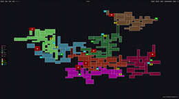
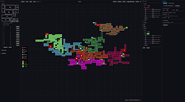
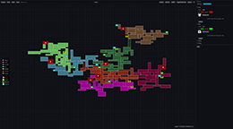
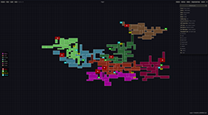
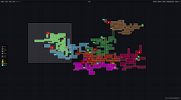
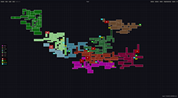

# Metroidvania Map Generator

A desktop tool that generates random Metroidvania style maps. Rooms are grouped by biome,
biomes are linked by corridors, and every room is reachable. You can pan, zoom, mark boss
and save rooms, place rooms by hand, tune the generation from a built-in editor, and
export the result.

Built with Rust and [egui](https://github.com/emilk/egui).

## Screenshots

[](docs/1.png)[](docs/2.png)[](docs/3.png)
[](docs/4.png)[](docs/5.png)[](docs/6.png)

## Features

- Random maps made of rectangular rooms on a grid, connected through doors.
- Biomes grown one after another, each linked to the map by a corridor.
- Secret rooms: 0 to 5 per biome, added as 1x1 dead ends.
- Portal rooms: 0 to 5 per biome, added as 1x1 dead ends.
- Save rooms: 0 to 5 per biome, added as 1x1 dead ends.
- Boss rooms: 0 to 5 per biome, with one entrance and one exit.
- Corridors: 0 to 5 per biome. Extra corridors join two biomes that face each other and
  create loops. Two corridors never come closer than 3 cells, diagonals included.
- Same seed and settings always give the same map.
- Boss, save, secret and portal rooms can also be set on any room with the keyboard.
  Each one replaces the previous type of the room.
- The same types can be set by dragging an icon from the room type legend onto a room.
  Dropping an icon on a room that already has it clears it, like the keys.
- Rooms, boss rooms and corridors can be placed by hand by dragging a size from the
  Rooms panel onto the map. They snap to the cell grid and get a door to each room
  they touch. See [Placing rooms](#placing-rooms).
- Placed rooms can be dragged with the left button to another spot. See
  [Moving rooms](#moving-rooms).
- The cursor shows what a click does: a hand on buttons, the seed, room sizes and
  legend icons, a cross when dragging a room over the map, arrows over a room that can
  be dragged, and a forbidden sign where a drop is refused.
- Faint white grid behind the map, one line per cell, toggled with G.
- Legend of the biomes and of the room types on the left.
- Room tooltip with its size in cells and in pixels.
- Clickable seed in the bottom right corner, copied to the clipboard.
- Editor panel for generation settings, room sizes and biomes.
- Biomes and settings saved as JSON. Biomes can be imported from any JSON file.
- Export of the map as a zip holding a PNG image, an SVG image and a JSON description.

## Download

Prebuilt files are available on the
[releases page](https://github.com/MrKitey/metroidvania-map-generator/releases):

- Windows: `metroidvania-map-generator-<version>-windows-x86_64.exe`. The file is not
  signed, so Windows SmartScreen shows a warning on first launch.
- Linux: `metroidvania-map-generator-<version>-linux-x86_64.AppImage`. Make it executable,
  then run it:

```sh
chmod +x metroidvania-map-generator-*-linux-x86_64.AppImage
./metroidvania-map-generator-*-linux-x86_64.AppImage
```

On Linux, the file dialogs for import and export need a running `xdg-desktop-portal`.

## Requirements

To build from source:

- Rust with edition 2024 support. Install it from [rustup.rs](https://rustup.rs).
- On Linux, the system libraries required by egui/wgpu and the file dialog:

```sh
# Debian, Ubuntu
apt install pkg-config libxkbcommon-dev libwayland-dev libvulkan-dev libx11-dev libxcursor-dev libxi-dev libxrandr-dev
# Fedora
dnf install libxkbcommon-devel wayland-devel vulkan-loader-devel libX11-devel libXcursor-devel libXi-devel libXrandr-devel
# Arch
pacman -S pkg-config libxkbcommon wayland vulkan-icd-loader libx11 libxcursor libxi libxrandr
```

## Build and run

```sh
git clone https://github.com/MrKitey/metroidvania-map-generator.git
cd metroidvania-map-generator
cargo run --release
```

Run the tests with `cargo test`.

## Controls

The same list is shown in the app with the `?` button in the top right corner.

| Input | Action |
|---|---|
| R | New map with a random seed |
| Mouse wheel | Zoom |
| Middle drag | Pan |
| Drag from Rooms | Place a room, see [Placing rooms](#placing-rooms) |
| Left drag | Move a room, see [Moving rooms](#moving-rooms) |
| Left drag on a legend icon | Drop a boss, save, secret or portal type on a room |
| C | Recenter the map |
| G | Show or hide the grid |
| B | Boss room under the cursor, press again to clear |
| S | Save room under the cursor, press again to clear |
| H | Secret room under the cursor, press again to clear |
| P | Portal room under the cursor, press again to clear |
| L | Open or close the room list |
| Tab | Open or close the editor |
| Esc | Close the shortcuts popup, cancel a room drag, a move or an icon drag, or quit |

Keyboard shortcuts other than Tab and L are disabled while the editor is open, so typing
in its fields is safe. L is ignored while a text field is focused.

The header holds four buttons in the top right corner:

- Rooms opens or closes the room list on the left. L does the same.
- Editor opens or closes the side panel. Tab does the same.
- Export writes the map zip. See [Export](#export).
- The `?` button opens the shortcuts popup.

## Placing rooms

Press L, or the Rooms button in the header, to open the panel on the left. It lists every
room size from the editor, in three sections: rooms, boss rooms and corridors. Each section
folds. Each size is drawn as a white outline with its size in the middle.

- Drag a size onto the map. The outline follows the cursor. On the map the room snaps to
  the cell grid, centered on the cursor cell. Each cell is one screen, so the position is
  always a multiple of the screen size in pixels, shown next to the cursor.
- The room is green where it fits and red where it overlaps another room.
- Release on a free spot to place it. Release off the map, or on a blocked spot, cancels.
  Right click or Esc cancels during the drag.
- The room gets one door per room it touches, in the middle of the shared side, and the
  biome of the first room it touches. Without a neighbor it has no door.
- Boss sizes place a room with the boss marker, corridor sizes place a corridor.
- Placed rooms are lost when the map is regenerated.

## Moving rooms

Press the left button on any room and keep it down to drag it. The room keeps the
grabbed point under the cursor and snaps to the cell grid. It is green where it fits and
red where it overlaps another room.

- Release the button to drop it. If the spot is taken, or the cursor is off the map,
  the room stays where it was. Right click or Esc cancels the drag.
- The doors of the room are removed. It gets one door per room it touches at the new
  spot, in the middle of the shared side, and the biome of the first room it touches, so
  its color follows. Without a neighbor it keeps its biome and has no door.
- The kind and the marker of the room are kept.
- A click without leaving the cell changes nothing.
- A room moved away from the others can leave the map in several parts.
- Moves are lost when the map is regenerated.

## Editor

Press Tab, or the Editor button in the header, to open the panel on the right.

**Settings tab**

- Seed: shows the current seed. Type one and press "Use seed" to rebuild that map.
- Screen size: size of one in-game screen in pixels. One cell stands for one screen.
- Min and max rooms per biome. Max 0 means no limit. Secret, portal, boss and save
  rooms are not counted, nor the room behind each boss.
- Room sizes: allowed room sizes in cells, from 1 to 10 per side. Add, edit, delete or
  reset them to the defaults.
- Boss room sizes: allowed sizes for boss rooms, edited the same way.
- Corridor room sizes: allowed sizes for corridors, edited the same way. The default is
  long and thin rooms, 3 to 5 cells. Extra corridors between biomes need a size 1 cell
  thick.
- "Generate" builds a new map with a random seed. "Save settings" writes `settings.json`.

Changes apply on the next generation.

**Biomes tab**

- One foldable entry per biome, with its name and a color picker.
- "Secret rooms", "Portal rooms", "Boss rooms" and "Save rooms" sliders: number of each
  in the biome, from 0 to 5, 1 by default. A boss room is followed by a normal room.
- "Corridors" slider: from 1 to 5, 1 by default. The first corridor links the biome to
  the map. Each other one is built from the biome to a room of another biome, if a free
  straight line exists. The first biome has no parent, so it only gets the others.
- Sliders apply on the next generation.
- "Add" creates a biome, "Import" loads biomes from a JSON file, "Save" writes
  `biomes.json`.

## Export

The export button opens a save dialog and writes a zip, named `map-<seed>.zip` by default:

- `map.png`: the whole map on a transparent background, with rooms, doors and icons.
  One cell is 32 pixels tall. Large maps are scaled down to fit 8192 pixels per side.
- `map.svg`: the same drawing as a vector image, also on a transparent background.
- `map.json`: the seed, the map size in cells, the settings, the biomes, and every room
  and door.

Rooms and doors in `map.json` use cell coordinates. `biome` is an index into `biomes`,
`a` and `b` are indices into `rooms`:

```json
{
  "seed": 1792399893864564562,
  "cells": 768,
  "rooms": [
    { "x": 0, "y": 0, "w": 1, "h": 3, "biome": 3, "kind": "normal", "marker": "boss" }
  ],
  "doors": [
    { "a": 0, "b": 1, "x": 1, "y": 2, "vertical": true }
  ]
}
```

`kind` is `normal`, `corridor`, `secret` or `portal`. `marker` is `boss`, `save` or `null`. A door is
on the left edge of cell (x, y) when `vertical` is true, otherwise on its top edge.

## Data files

Files are stored in `Documents/Metroidvania Map Generator/`, in the user's Documents folder.
If that folder cannot be found, the working directory is used. Missing or invalid files
fall back to the defaults.

`biomes.json`, also the format used by "Import". `corridors`, `secrets`, `portals`, `bosses` and `saves` default to 1 when missing:

```json
[
  { "name": "Castle", "color": "#465078", "corridors": 1, "secrets": 1, "portals": 1, "bosses": 1, "saves": 1 },
  { "name": "Caves", "color": "#64462D", "corridors": 3, "secrets": 2, "portals": 0, "bosses": 0, "saves": 2 }
]
```

`settings.json`. Missing keys take their default value:

```json
{
  "viewport": [640, 360],
  "min_rooms": 5,
  "max_rooms": 50,
  "room_sizes": [[1, 1], [2, 1], [1, 2], [2, 2]],
  "boss_sizes": [[2, 2], [2, 3], [3, 3]],
  "corridor_sizes": [[3, 1], [4, 1], [5, 1], [1, 3], [1, 4], [1, 5]]
}
```

## Releases

Pushing a tag such as `v0.4.0` runs `.github/workflows/release.yml`. It builds the Windows
`.exe` and the Linux AppImage, then publishes both in a GitHub release.

- The tag must match the `version` in `Cargo.toml`, otherwise the workflow fails.
- The workflow builds with `--locked`. After changing the version, run `cargo build` so
  `Cargo.lock` is updated, and commit both files together.

```sh
git tag v0.4.0
git push origin v0.4.0
```

## Project structure

```
assets/icon.png, icon.ico  App icon for the AppImage and the Windows executable
assets/icons/              Boss, save, secret and portal icons, embedded at build time
packaging/linux/           Desktop entry for the AppImage
.github/workflows/         Release workflow
build.rs                   Embeds the icon into the Windows executable
src/main.rs                Window and egui loop
src/app/                  Frame loop (mod.rs), project session, header, map panel, gestures
src/world/                 Map data (mod.rs), generation (generate.rs), manual edits (edit.rs)
src/render/                Frame drawing (mod.rs), map (map.rs), overlays (hud.rs),
                           legends (legend.rs), room picker (picker.rs), size packing (pack.rs),
                           colors (theme.rs)
src/layout.rs              Cell size and header height
src/view.rs                Camera pan, zoom and fit
src/editor/                Editor panel: state (mod.rs), validated fields (fields.rs),
                           settings tab, biomes tab and shared widgets
src/biome.rs               Biomes and biomes.json
src/settings.rs            Generation settings and settings.json
src/storage.rs             App folder and JSON reading and writing
src/text/                  All app texts, one file per area
src/color.rs               #RRGGBB conversion
src/icons.rs               SVG icon rasterization
src/export/                Zip export (mod.rs) with map.png, map.svg and map.json
src/project/               Project file, dialogs, recent list and Linux mime type
src/platform/              Wayland file drop
```

## License

[MIT](LICENSE)
