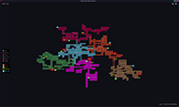
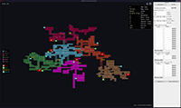
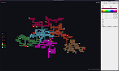

# Metroidvania Map Generator

A desktop tool that generates random Metroidvania style maps. Rooms are grouped by biome,
biomes are linked by corridors, and every room is reachable. You can pan, zoom, mark boss
and save rooms, tune the generation from a built-in editor, and export the result.

Built with Rust and [macroquad](https://github.com/not-fl3/macroquad).

[](docs/screenshot.png)
[](docs/screenshot-2.png)
[](docs/screenshot-3.png)

## Features

- Random maps made of rectangular rooms on a grid, connected through doors.
- Biomes grown one after another, each linked to the map by a corridor.
- Secret rooms: 0 to 5 per biome, added as 1x1 dead ends.
- Portal rooms: 0 to 5 per biome, added as 1x1 dead ends.
- Save rooms: 0 to 5 per biome, added as 1x1 dead ends.
- Boss rooms: 0 to 5 per biome, with one entrance and one exit.
- Corridors: 0 to 5 per biome. Extra corridors join two biomes that face each other and
  create loops. Two corridors never come closer than 3 cells, diagonals included.
- Same seed and settings always give the same map.
- Boss, save, secret and portal rooms can also be set on any room with the keyboard.
  Each one replaces the previous type of the room.
- Legend of the biomes and of the room types on the left.
- Room tooltip with its size in cells and in pixels.
- Clickable seed in the bottom right corner, copied to the clipboard.
- Editor panel for generation settings, room sizes and biomes.
- Biomes and settings saved as JSON. Biomes can be imported from any JSON file.
- Export of the map as a zip holding a PNG image and a JSON description.

## Download

Prebuilt files are available on the
[releases page](https://github.com/MrKitey/metroidvania-map-generator/releases):

- Windows: `metroidvania-map-generator-<version>-windows-x86_64.exe`. The file is not
  signed, so Windows SmartScreen shows a warning on first launch.
- Linux: `metroidvania-map-generator-<version>-linux-x86_64.AppImage`. Make it executable,
  then run it:

```sh
chmod +x metroidvania-map-generator-*-linux-x86_64.AppImage
./metroidvania-map-generator-*-linux-x86_64.AppImage
```

On Linux, the file dialogs for import and export need a running `xdg-desktop-portal`.

## Requirements

To build from source:

- Rust with edition 2024 support. Install it from [rustup.rs](https://rustup.rs).
- On Linux, the system libraries required by macroquad and the file dialog:

```sh
# Debian, Ubuntu
apt install pkg-config libx11-dev libxi-dev libgl1-mesa-dev libasound2-dev libwayland-dev
# Fedora
dnf install libX11-devel libXi-devel mesa-libGL-devel alsa-lib-devel wayland-devel
# Arch
pacman -S pkg-config libx11 libxi mesa-libgl alsa-lib wayland
```

## Build and run

```sh
git clone https://github.com/MrKitey/metroidvania-map-generator.git
cd metroidvania-map-generator
cargo run --release
```

## Controls

The same list is shown in the app with the `?` button in the top right corner.

| Input | Action |
|---|---|
| R | New map with a random seed |
| Right / Up arrows | Bigger map |
| Left / Down arrows | Smaller map |
| Mouse wheel | Zoom |
| Middle drag | Pan |
| C | Recenter the map |
| B | Boss room under the cursor, press again to clear |
| S | Save room under the cursor, press again to clear |
| H | Secret room under the cursor, press again to clear |
| P | Portal room under the cursor, press again to clear |
| Tab | Open or close the editor |
| Esc | Close the shortcuts popup, or quit |

Keyboard shortcuts other than Tab are disabled while the editor is open, so typing in its
fields is safe.

The header holds two buttons in the top right corner:

- The download arrow exports the map. See [Export](#export).
- The `?` button opens the shortcuts popup.

## Editor

Press Tab to open the panel on the right.

**Settings tab**

- Seed: shows the current seed. Type one and press "Use seed" to rebuild that map.
- Screen size: size of one in-game screen in pixels. One cell stands for one screen.
- Min and max rooms per biome. Max 0 means no limit. Secret, portal, boss and save
  rooms are not counted, nor the room behind each boss.
- Room sizes: allowed room sizes in cells, from 1 to 10 per side. Add, edit, delete or
  reset them to the defaults.
- Boss room sizes: allowed sizes for boss rooms, edited the same way.
- Corridor room sizes: allowed sizes for corridors, edited the same way. The default is
  long and thin rooms, 3 to 5 cells. Extra corridors between biomes need a size 1 cell
  thick.
- "Generate" builds a new map with a random seed. "Save settings" writes `settings.json`.

Changes apply on the next generation.

**Biomes tab**

- One foldable entry per biome, with its name, a hex color field and a color picker.
- "Secret rooms", "Portal rooms", "Boss rooms" and "Save rooms" sliders: number of each
  in the biome, from 0 to 5, 1 by default. A boss room is followed by a normal room.
- "Corridors" slider: from 1 to 5, 1 by default. The first corridor links the biome to
  the map. Each other one is built from the biome to a room of another biome, if a free
  straight line exists. The first biome has no parent, so it only gets the others.
- Sliders apply on the next generation.
- "Add" creates a biome, "Import" loads biomes from a JSON file, "Save" writes
  `biomes.json`.

## Export

The export button opens a save dialog and writes a zip, named `map-<seed>.zip` by default:

- `map.png`: the whole map on a transparent background, with rooms, doors and icons.
  One cell is 32 pixels tall. Large maps are scaled down to fit 8192 pixels per side.
- `map.json`: the seed, the map size in cells, the settings, the biomes, and every room
  and door.

Rooms and doors in `map.json` use cell coordinates. `biome` is an index into `biomes`,
`a` and `b` are indices into `rooms`:

```json
{
  "seed": 1792399893864564562,
  "cells": 768,
  "rooms": [
    { "x": 0, "y": 0, "w": 1, "h": 3, "biome": 3, "kind": "normal", "marker": "boss" }
  ],
  "doors": [
    { "a": 0, "b": 1, "x": 1, "y": 2, "vertical": true }
  ]
}
```

`kind` is `normal`, `corridor`, `secret` or `portal`. `marker` is `boss`, `save` or `null`. A door is
on the left edge of cell (x, y) when `vertical` is true, otherwise on its top edge.

## Data files

Files are stored in `Documents/Metroidvania Map Generator/`, in the user's Documents folder.
If that folder cannot be found, the working directory is used. Missing or invalid files
fall back to the defaults.

`biomes.json`, also the format used by "Import". `corridors`, `secrets`, `portals`, `bosses` and `saves` default to 1 when missing:

```json
[
  { "name": "Castle", "color": "#465078", "corridors": 1, "secrets": 1, "portals": 1, "bosses": 1, "saves": 1 },
  { "name": "Caves", "color": "#64462D", "corridors": 3, "secrets": 2, "portals": 0, "bosses": 0, "saves": 2 }
]
```

`settings.json`. Missing keys take their default value:

```json
{
  "viewport": [640, 360],
  "min_rooms": 5,
  "max_rooms": 50,
  "room_sizes": [[1, 1], [2, 1], [1, 2], [2, 2]],
  "boss_sizes": [[2, 2], [2, 3], [3, 3]],
  "corridor_sizes": [[3, 1], [4, 1], [5, 1], [1, 3], [1, 4], [1, 5]]
}
```

## Releases

Pushing a tag such as `v0.3.0` runs `.github/workflows/release.yml`. It builds the Windows
`.exe` and the Linux AppImage, then publishes both in a GitHub release.

- The tag must match the `version` in `Cargo.toml`, otherwise the workflow fails.
- The workflow builds with `--locked`. After changing the version, run `cargo build` so
  `Cargo.lock` is updated, and commit both files together.

```sh
git tag v0.3.0
git push origin v0.3.0
```

## Project structure

```
assets/icon.png, icon.ico  App icon for the AppImage and the Windows executable
assets/icons/              Boss, save, secret and portal icons, embedded at build time
packaging/linux/           Desktop entry for the AppImage
.github/workflows/         Release workflow
build.rs                   Embeds the icon into the Windows executable
src/main.rs                Window, main loop and input
src/world.rs               Map generation
src/render.rs              Map, header, legend, tooltip and shortcuts popup drawing
src/view.rs                Camera pan, zoom and fit
src/editor.rs              Editor panel
src/biome.rs               Biomes and biomes.json
src/settings.rs            Generation settings and settings.json
src/storage.rs             App folder and JSON reading and writing
src/icons.rs               SVG icon rasterization
src/export.rs              Zip export with map.png and map.json
```

## License

[MIT](LICENSE)
