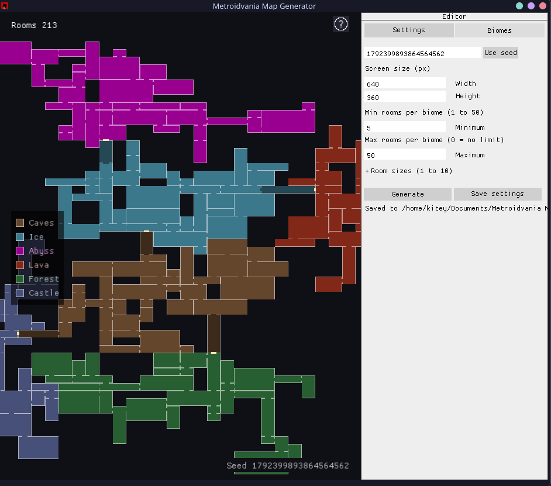

# Metroidvania Map Generator

A desktop tool that generates random Metroidvania style maps. Rooms are grouped by biome,
biomes are linked by corridors, and every room is reachable. You can pan, zoom, mark boss
and save rooms, and tune the generation from a built-in editor.

Built with Rust and [macroquad](https://github.com/not-fl3/macroquad).



## Features

- Random maps made of rectangular rooms on a grid, connected through doors.
- Biomes grown one after another, each linked to the map by a corridor.
- Same seed and settings always give the same map.
- Boss and save markers on any room.
- Room tooltip with its size in cells and in pixels.
- Clickable seed in the bottom right corner, copied to the clipboard.
- Editor panel for generation settings, room sizes and biomes.
- Biomes and settings saved as JSON. Biomes can be imported from any JSON file.

## Requirements

- Rust with edition 2024 support. Install it from [rustup.rs](https://rustup.rs).
- On Linux, the system libraries required by macroquad:

```sh
# Debian, Ubuntu
apt install pkg-config libx11-dev libxi-dev libgl1-mesa-dev libasound2-dev
# Fedora
dnf install libX11-devel libXi-devel mesa-libGL-devel alsa-lib-devel
# Arch
pacman -S pkg-config libx11 libxi mesa-libgl alsa-lib
```

- On Linux, a running `xdg-desktop-portal` for the biome import file dialog.

## Build and run

```sh
git clone https://github.com/MrKitey/metroidvania-map-generator.git
cd metroidvania-map-generator
cargo run --release
```

## Controls

The same list is shown in the app with the `?` button in the top right corner.

| Input | Action |
|---|---|
| R | New map with a random seed |
| Right / Up arrows | Bigger map |
| Left / Down arrows | Smaller map |
| Mouse wheel | Zoom |
| Middle drag | Pan |
| C | Recenter the map |
| Left click on a room | Toggle boss marker |
| Right click on a room | Toggle save marker |
| Tab | Open or close the editor |
| Esc | Close the shortcuts popup, or quit |

Keyboard shortcuts other than Tab are disabled while the editor is open, so typing in its
fields is safe.

## Editor

Press Tab to open the panel on the right.

**Settings tab**

- Seed: shows the current seed. Type one and press "Use seed" to rebuild that map.
- Screen size: size of one in-game screen in pixels. One cell stands for one screen.
- Min and max rooms per biome. Max 0 means no limit.
- Room sizes: allowed room sizes in cells, from 1 to 10 per side. Add, edit, delete or
  reset them to the defaults.
- "Generate" builds a new map with a random seed. "Save settings" writes `settings.json`.

Changes apply on the next generation.

**Biomes tab**

- One foldable entry per biome, with its name, a hex color field and a color picker.
- "Add" creates a biome, "Import" loads biomes from a JSON file, "Save" writes
  `biomes.json`.

## Data files

Files are stored in `Documents/Metroidvania Map Generator/`, in the user's Documents folder.
If that folder cannot be found, the working directory is used. Missing or invalid files
fall back to the defaults.

`biomes.json`, also the format used by "Import":

```json
[
  { "name": "Castle", "color": "#465078" },
  { "name": "Caves", "color": "#64462D" }
]
```

`settings.json`. Missing keys take their default value:

```json
{
  "viewport": [640, 360],
  "min_rooms": 5,
  "max_rooms": 50,
  "room_sizes": [[1, 1], [2, 1], [1, 2], [2, 2]]
}
```

## Project structure

```
assets/icons/   Boss and save marker icons, embedded at build time
src/main.rs     Window, main loop and input
src/world.rs    Map generation
src/render.rs   Map, header, legend, tooltip and shortcuts popup drawing
src/view.rs     Camera pan, zoom and fit
src/editor.rs   Editor panel
src/biome.rs    Biomes and biomes.json
src/settings.rs Generation settings and settings.json
src/storage.rs  App folder and JSON reading and writing
src/icons.rs    SVG icon rasterization
```

## License

[MIT](LICENSE)
